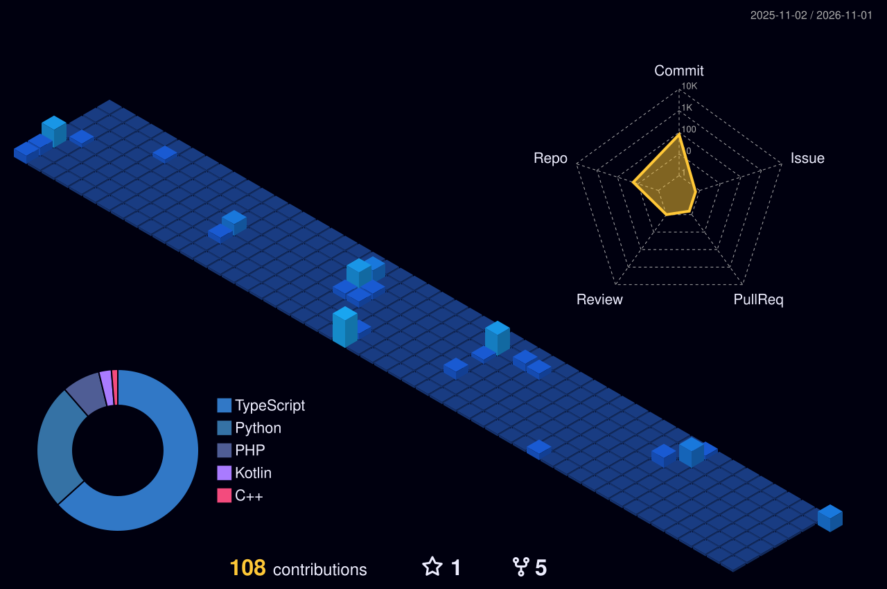

## 🌃 Contributions, as a night-view city

> The city above is generated by [`yoshi389111/github-profile-3d-contrib`](https://github.com/yoshi389111/github-profile-3d-contrib) via `.github/workflows/profile-3d.yml` and refreshed daily. Run the workflow once (Actions tab → *GitHub-Profile-3D-Contrib* → *Run workflow*) to create the first image.

## 🚀 Projects

| Project | What it is | Stack |
| :-- | :-- | :-- |
| [**NexusHire**](https://github.com/Soham792/NexusHire) | AI-powered recruitment platform with 3D skill-match and auto-apply. | `React · LLMs · 3D` |
| [**PanelSena**](https://github.com/Soham792/PanelSena) | Cloud digital signage control for Raspberry Pi displays. | `Kotlin · Firebase` |
| [**PromptInjection**](https://github.com/Soham792/PromptInjection) | Prompt injection attacks and defenses against LLM apps. | `Python · LLM Security` |

## 🤝 Connect

[GitHub](https://github.com/Soham792) &nbsp;·&nbsp; [LinkedIn](https://www.linkedin.com/in/marathesoham) &nbsp;·&nbsp; [X]() &nbsp;·&nbsp; [Email](mailto:sohammarathe3@gmail.com)

